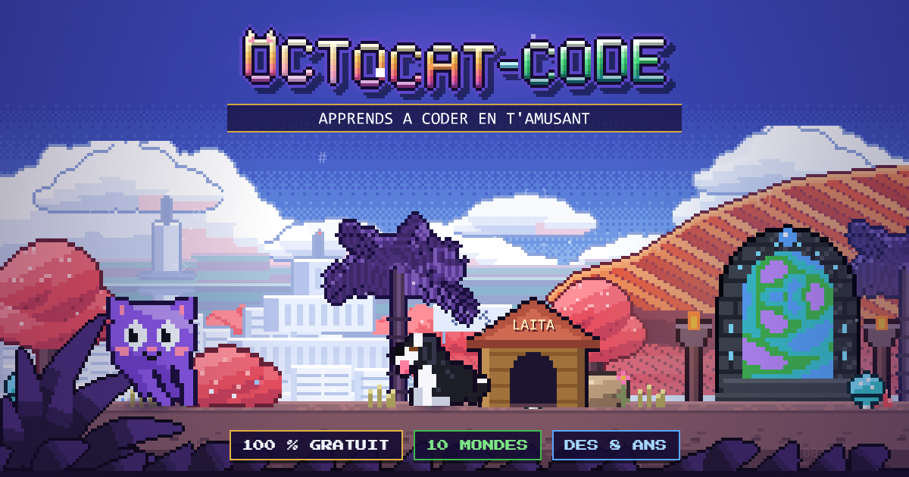

<p align="center">
  
</p>

# 🐙 OCTOCAT-CODE

**Apprends à coder en t'amusant.** Jeu d'aventure rétro 2D, gratuit et en français, qui se joue dans le navigateur (ordinateur, tablette, téléphone) : *le site est le jeu*.

[](https://github.com/INDFORGE-Studio/OctoCat-Code/actions/workflows/deploy.yml)

### ▶ [Jouer maintenant : indforge-studio.github.io/OctoCat-Code](https://indforge-studio.github.io/OctoCat-Code/)

Rien à installer, pas de compte : la progression reste dans ton navigateur et le jeu marche même hors connexion une fois chargé.

## Le jeu

Tu guides **OctoCat**, un chat-pieuvre violet, et **Laita**, sa fidèle chienne, à travers **10 mondes**. Chaque monde se joue en deux temps : un **trajet** au clavier (plateformes à la Mario, fouet à la Castlevania, ninja à la Shinobi, beat'em up à la Double Dragon), puis une **énigme de code** à résoudre pour ouvrir le portail vers le monde suivant.

Tu apprends : variables, textes, calculs, logique (`et` / `ou` / `non`), conditions (`si` / `sinon`), boucles `pour` et `tant que` (avec un boss à la fin). Les énigmes s'écrivent en **Python**, **JavaScript** ou **pseudo-code** : après chaque tour de 10 mondes, on change d'apparence et de langage. Trois tours, puis le générique de fin.

| Touche | Action |
|---|---|
| Flèches ou WASD (ZQSD) | se déplacer |
| Espace | sauter |
| Clic gauche ou X | frapper |
| **F** (ou C, K) | lancer un shuriken |
| Clic droit ou V | appeler Laita |
| Échap | réglages (touches, son, affichage) et pause |

Sur téléphone et tablette, des boutons apparaissent à l'écran. Petit secret : dans les énigmes, clique sur les deux torches du portail…

## Fait pour être léger et ouvert

- **100 % statique**, hébergé sur GitHub Pages : < 1 Mo à télécharger.
- **Aucune image, aucun fichier de son** : le pixel art et la musique sont générés par le code (canvas et WebAudio).
- Le code du joueur n'est **jamais** exécuté avec `eval` : c'est un interpréteur à liste blanche.
- Moteur 2D [KAPLAY](https://kaplayjs.com) (MIT), police pixel Press Start 2P (OFL), site généré avec [Material for MkDocs](https://squidfunk.github.io/mkdocs-material/).

## Développer

```bash
pip install -r requirements.txt
npm install
mkdocs serve                      # http://127.0.0.1:8000/OctoCat-Code/
npm run check                     # lint, tests (dont un bot qui termine les 10 parcours), build strict + garde
```

Vérifications dans un vrai navigateur (Playwright + Chromium) : `node dev/run-check.mjs` (rejoue le jeu), `dev/notfound-check.mjs` (page 404), `dev/perf-check.mjs` (démarrage et profil CPU), et les autres `dev/*-check.mjs`. `node dev/icons.mjs` et `node dev/social.mjs` régénèrent les icônes et l'image de partage.

| Chemin | Rôle |
|---|---|
| `mkdocs.yml` | Configuration MkDocs, scripts du jeu (ordre significatif) |
| `docs/index.md` | La page : texte pour les moteurs de recherche, le jeu vit dans le canvas |
| `overrides/` | Gabarits sans thème : `octo-base.html` (balises SEO, icônes), `game.html`, `404.html` |
| `docs/javascripts/engine.js`, `progress.js`, `langs.js` | Moteur de scènes, interpréteur, progression, tours et langages |
| `docs/javascripts/sprites*.js`, `scenery.js`, `music.js` | Pixel art et sons synthétisés |
| `docs/javascripts/playsim.js`, `play.js` | Trajets : simulation pure (testée sous Node) et rendu |
| `docs/javascripts/level1.js` … `level10.js` | Un monde : trajet, briefing, énigme, validation |
| `docs/javascripts/hub.js`, `credits.js`, `notfound.js` | Accueil, générique de fin, page 404 |
| `tools/postbuild.py` | Garde post-build : site auto-contenu, thème inutilisé retiré, budget de taille |

Voir [`CLAUDE.md`](CLAUDE.md) pour l'architecture détaillée et les consignes de travail.

## Crédits et licences tierces

| Composant | Licence | Texte |
|---|---|---|
| [KAPLAY](https://kaplayjs.com) (`docs/javascripts/vendor/`) | MIT | `docs/assets/licenses/kaplay-MIT.txt` |
| Police Press Start 2P (`docs/assets/fonts/`) | SIL OFL 1.1 | `docs/assets/licenses/press-start-2p-OFL.txt` |
| [Material for MkDocs](https://squidfunk.github.io/mkdocs-material/) | MIT | (dépendance de build, non redistribuée) |

Les sprites, le décor et la musique sont créés pour le projet (procéduraux). Ce projet n'est pas affilié à GitHub : « GitHub » et « Octocat » sont des marques de GitHub, Inc. ; l'OctoCat du jeu est un personnage original (chat-pieuvre violet). Laita est inspirée de la vraie Laita.

Licence du projet : à définir par INDFORGE Studio (aucune licence n'est accordée tant qu'elle n'est pas ajoutée).
